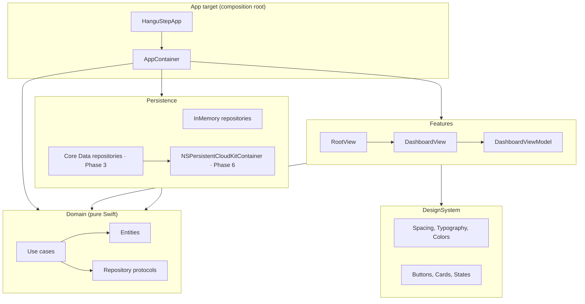
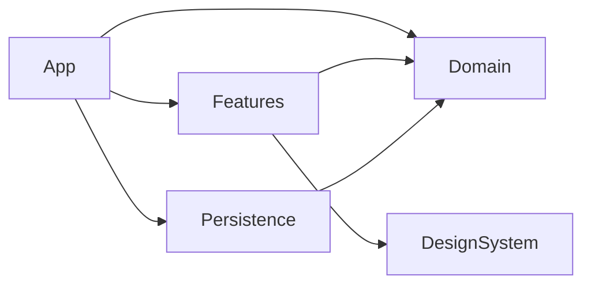

# HanguStep Architecture

Version 0.1 · Phase 1 deliverable

## 1. Overview

Clean Architecture with MVVM presentation, delivered as one local Swift package with four targets plus a thin app target. Dependencies point inward only. The compiler enforces the boundaries: a target cannot import something it does not declare.



## 2. Module dependency graph



| Target | May import | Must never import | Contains |
|---|---|---|---|
| Domain | Foundation | SwiftUI, CoreData, CloudKit, any other target | Entities, repository protocols, use cases, `DomainError`, `DateProvider` |
| Persistence | Domain, Foundation, CoreData, CloudKit | SwiftUI, Features | Repository implementations, Core Data stack, content importer, sample data |
| DesignSystem | SwiftUI | Domain, Features | Tokens and reusable components, no business types |
| Features | Domain, DesignSystem, SwiftUI | Persistence | Views, view models, navigation |
| App | everything | — | `@main`, `AppContainer` |

Why not thirty modules: four targets already give compiler-checked layering. Splitting Features per screen only pays off when build times or team size demand it.

## 3. Folder structure

```
HanguStep/
├── App/                          # app target, composition root only
│   ├── HanguStepApp.swift
│   └── AppContainer.swift
├── Packages/HanguStepKit/
│   ├── Package.swift
│   ├── Sources/
│   │   ├── Domain/
│   │   │   ├── Entities/         # VocabularyItem, GrammarPattern, Question, Attempt, ...
│   │   │   ├── Repositories/     # protocols only
│   │   │   ├── UseCases/         # one file per use case
│   │   │   ├── Identifiers.swift # typed IDs
│   │   │   ├── DomainError.swift
│   │   │   └── DateProvider.swift
│   │   ├── Persistence/
│   │   │   ├── InMemory/         # previews, tests, Phase 1 skeleton
│   │   │   ├── CoreData/         # Phase 3
│   │   │   └── SampleContent.swift
│   │   ├── DesignSystem/         # Phase 2 fills this
│   │   └── Features/
│   │       ├── Navigation/       # AppSection, RootView
│   │       ├── Dashboard/        # one folder per feature: View + ViewModel
│   │       └── Placeholders/
│   └── Tests/
│       ├── DomainTests/
│       ├── PersistenceTests/
│       └── FeaturesTests/
├── Documentation/
├── project.yml                   # xcodegen spec, source of truth for the project file
├── HanguStep.xcodeproj           # generated, committed so Xcode opens without tooling
└── .github/workflows/ci.yml
```

## 4. Domain boundaries

Three bounded contexts share one Domain target but never share identity:

- **Content** (read-only, bundled): `VocabularyItem`, `GrammarPattern`, `Question`. Identified by authored string IDs such as `vocab.topik1.0001`. Never written by the learner, never synced.
- **Learner** (read-write, synced): `Attempt`, `Bookmark`, `ReviewSchedule`, later `StudySession`, `LearnerNote`, `Settings`. Reference content only through `LearningTarget` or a content ID value. No object graph edges cross from Learner to Content.
- **Statistics** (derived): `AttemptSummary`, `DashboardSummary`. Always computed from Learner records, never persisted.

Rules:

1. Entities are `struct`, `Sendable`, `Codable`, value-equal. No class entities, no reference semantics.
2. Managed objects never leave Persistence. Repositories map to and from domain structs.
3. Use cases are the only entry point from Features into Domain logic. A view model never calls a repository directly.
4. One use case = one business operation, exposed as a protocol plus a default implementation.

## 5. Repository interfaces

Declared in `Sources/Domain/Repositories`. All are `Sendable` protocols with `async throws` methods.

| Protocol | Context | Key operations |
|---|---|---|
| `VocabularyRepository` | Content | `item(id:)`, `items(matching:)`, `search(_:filter:)`, `count()` |
| `GrammarRepository` | Content | `pattern(id:)`, `patterns(level:)`, `count()` |
| `QuestionRepository` | Content | `question(id:)`, `questions(ids:)`, `questions(matching:)`, `count()` |
| `AttemptRepository` | Learner | `record(_:)` (rejects duplicates), `attempts(inSession:)`, `attempts(forQuestion:)`, `summary()` |
| `BookmarkRepository` | Learner | `add`, `remove(target:)`, `contains(target:)`, `all()` |
| `ReviewScheduleRepository` | Learner | `schedule(for:)`, `upsert`, `due(onOrBefore:limit:)` |

Phase 3 added `StudySessionRepository`, `LearnerNoteRepository`, `LearnerSettingsRepository` and the `ContentStore` write side. All are implemented twice: in memory (previews, tests) and Core Data (app).

### Use cases (Phase 4)

| Area | Use cases |
|---|---|
| Library | `BrowseVocabulary`, `GetVocabularyDetail`, `BrowseGrammar`, `GetGrammarDetail`, `ToggleBookmark`, `ListBookmarks`, `SaveNote` |
| Quiz | `StartQuizSession`, `ResumeQuizSession`, `SubmitAnswer`, `FinishQuizSession` (+ `QuizScoring`) |
| Review | `ListMistakes` (+ pure `MistakeDerivation`), `ListQuizHistory` |
| Settings | `LoadSettings`, `SaveSettings` |

### Use cases (Phase 5)

| Area | Use cases |
|---|---|
| Spaced repetition | pure `SM2` + `ReviewQuality`; schedule update inside `SubmitAnswer`; `QuizPool.review` in `StartQuizSession`; `ListReviewQueue` |
| Progress | pure `ProgressStatistics` (totals, today, 7/30-day activity, streaks, weak items); `LoadDashboardSummary` (extended), `LoadProgressReport` |

Rules for quality mapping, due dates, mastery and streaks are in ADR-006. `ReviewScheduleRepository.all()` was added so due and mastered counts derive from rows rather than a cached counter.

Each is a protocol plus a default struct. Randomness (`Shuffler`), ids (`IDGenerator`) and time (`DateProvider`) are injected so every use case is deterministic under test.

## 6. Dependency injection

Manual constructor injection, no container framework.

- `AppContainer` (App target, `@MainActor`) builds repositories once, composes use cases, and produces `AppDependencies`.
- `AppDependencies` (Features) is a `Sendable` struct of use-case protocols. It is the only thing Features receives.
- Views construct their view model in `init` with `@State`, pulling use cases from `AppDependencies`.
- Tests inject stubs that conform to the use-case or repository protocols. No shared mutable singletons.

Trade-off: `AppDependencies` grows one field per use case. Accepted; it stays a plain list and is grep-able. If it exceeds roughly 25 fields, split per feature.

## 7. Navigation

- `AppSection` enumerates the five top-level destinations.
- iPhone compact width: `TabView`, one `NavigationStack` per tab so each keeps its own stack.
- iPad regular width and macOS: `NavigationSplitView` with a sidebar `List` bound to the same `AppSection` selection.
- In-feature navigation (Phase 4 onward): each feature defines a `Hashable` route enum and uses `navigationDestination(for:)` inside its own stack. Deep links map to `(AppSection, [Route])`.
- No global router object. Routes are values; the stack owns the path.
- The quiz runs in a modal sheet (`quizSheet`) with interactive dismissal disabled. Closing early finishes the session and keeps answered questions; the view model owns the state machine (`loading → answering → feedback → finished`).
- `LearnerPreferences` (`@Observable`, main actor) is injected through the environment and is the single reader of settings for gloss order and pronunciation.
- Phase 5 screens: `DashboardView` (streak, due tile → `ReviewQueueView`, goal ring, 7-day Swift Charts strip, Start review), `ProgressScreen` (stat grid, 30-day chart, goal card, weak words and grammar, link to `HistoryView`). Charts carry an accessibility label and a plain-text summary.

## 8. Concurrency

Swift 6 language mode, strict concurrency complete, zero `@unchecked Sendable`.

| Layer | Isolation |
|---|---|
| Entities | `Sendable` value types |
| Repositories | `actor` (in-memory) or actor wrapping a background `NSManagedObjectContext` (Core Data). Methods `async throws`. |
| Use cases | `Sendable` structs. May fan out with `async let`. |
| View models | `@MainActor @Observable final class`. All state mutation on main. |
| Views | Call `await viewModel.load()` in `.task`, which cancels on disappear. |

Rules: no `DispatchQueue`, no `Task.detached` without a written reason, no managed object crossing an actor boundary, `DateProvider` injected wherever "now" matters.

## 9. Error handling

- Domain defines `DomainError` with typed cases. Repositories translate framework errors into `.storage(description:)`.
- Use cases propagate; they do not swallow.
- View models convert errors into state (`.failed(message:)`), never `print`, never `fatalError`.
- Views render failure states with `ContentUnavailableView` and a retry action.
- Content validation returns `[ContentValidationIssue]`, not a thrown error, so importers can report everything at once.
- Sync errors (Phase 6) are surfaced on the Settings screen, never as blocking alerts.

## 10. Build and verification

```
cd Packages/HanguStepKit && swift test
xcodegen generate
xcodebuild build -project HanguStep.xcodeproj -scheme HanguStep -destination 'generic/platform=iOS Simulator' CODE_SIGNING_ALLOWED=NO
xcodebuild build -project HanguStep.xcodeproj -scheme HanguStep -destination 'platform=macOS' CODE_SIGN_IDENTITY=-
```

CI runs the first and third on every pull request.

## 11. Decision log

See `ADR/`. Current: ADR-001 architecture and modularization, ADR-002 persistence, ADR-003 cloud sync, ADR-004 concurrency, ADR-005 navigation and DI.
