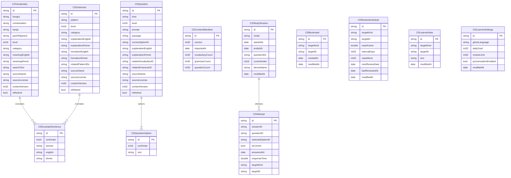

# HanguStep Database Schema

Version 0.2 · Phase 3 · Status: design approved 2026-11-02, implemented, in review

## 1. Decisions in one paragraph

Core Data, one `NSPersistentContainer`, two persistent stores selected by model configuration. The **Content** store holds the bundled library (vocabulary, grammar, questions) and is never mirrored to CloudKit. The **Learner** store holds everything the user produces and is the only store mirrored in Phase 6. No relationship crosses the two stores; learner rows point at content with a string `contentID`. Every entity has a client-generated string `id`. Uniqueness is enforced in repository code, never with Core Data constraints, because CloudKit rejects them. Mistakes, statistics and streaks are derived from attempts at query time and are not stored.

Why derived instead of a `LearningProgress` table: a stored counter is a sync conflict waiting to happen (two devices increment independently, last writer wins, count is wrong). Attempts are append-only, so both devices' rows survive and the count is always right.

## 2. Entity relationship diagram



## 3. Store configurations

| Store | Configuration name | File | CloudKit | Lifecycle |
|---|---|---|---|---|
| Content | `Content` | `Content.sqlite` | No | Rebuilt from bundled JSON when the manifest version changes. Can be deleted and re-imported at any time without data loss. |
| Learner | `Learner` | `Learner.sqlite` | Yes, from Phase 6 (`NSPersistentCloudKitContainerOptions` on this description only) | Never deleted except by explicit user reset. |

Each entity belongs to exactly one configuration. Core Data refuses relationships across configurations, which is exactly the guarantee we want.

## 4. Attribute rules

### Both stores

- `id`: client-generated string, indexed. Content IDs are authored (`vocab.topik1.0001`). Learner IDs are `UUID().uuidString` lowercased.
- All string attributes have a default of `""`, numeric attributes default `0`, booleans default `false`. Dates are optional. This satisfies the CloudKit rule that every attribute is optional or has a default.
- No `Transformable` attributes. Lists are stored as JSON-encoded strings (`relatedPatternIDs`, `questionIDs`) because they are small and never queried by element.
- Enum-like attributes (`partOfSpeech`, `kind`, `mode`, `targetKind`, `glossLanguage`) are stored as their `rawValue` string. Unknown values decode to a fallback so an old app build can read rows written by a newer one.

### Content store specifics

- `searchText`: precomputed, normalized concatenation of hangul, romanization, English and Khmer (see `TextNormalizer`). Indexed. Search runs `CONTAINS[cd]` against this one column instead of four.
- `isRetired`: content removed in a later version is flagged, not deleted, so learner attempts keep pointing at a readable question (PRD FR-C2).
- Relationships (`examples`, `options`) are ordinary to-many with cascade delete, ordered by `sortOrder`. No ordered relationships (CloudKit forbids them; keep the habit uniform).
- Compound index on `(level, partOfSpeech)` for the filtered list.

### Learner store specifics

- `targetKind` + `targetID` replace a polymorphic relationship. Index on `(targetKind, targetID)`.
- `CDAttempt` denormalizes `targetKind`/`targetID` from the question at write time so mistakes and weak-item queries never need the content store.
- `CDStudySession.questionIDs` is the frozen question list for resume. `currentIndex` plus the attempt rows restore the exact position.
- `CDStudySession.attempts` is an optional to-many with nullify delete. `CDAttempt` has no inverse back to the session as a required field; `sessionID` string is the source of truth so a session row arriving from CloudKit after its attempts still links.
- `modifiedAt` on every mutable learner entity. Phase 6 merge policy uses it.
- No uniqueness constraints. Repositories check before insert; `LearnerDeduplicator` runs after CloudKit imports with the per-entity policy in `CLOUDKIT_SYNC.md` §5 (schedules keep the latest `lastReviewedAt`, attempts the earliest `answeredAt`, everything else the latest `modifiedAt`).

## 5. Mapping to domain

Managed objects never leave the Persistence target. Each repository maps rows to the domain structs defined in Phase 1:

| Domain | Core Data |
|---|---|
| `VocabularyItem` | `CDVocabulary` + `CDExampleSentence` |
| `GrammarPattern` | `CDGrammar` + `CDExampleSentence` |
| `Question` + `QuestionOption` | `CDQuestion` + `CDQuestionOption` |
| `Attempt` | `CDAttempt` |
| `Bookmark` | `CDBookmark` |
| `ReviewSchedule` | `CDReviewSchedule` |
| `StudySession` (new in this phase) | `CDStudySession` |
| `LearnerNote` (new) | `CDLearnerNote` |
| `LearnerSettings` (new) | `CDLearnerSettings` |
| `ContentSource` | `sourceName`, `sourceLicense` columns |

New domain types added in Phase 3: `StudySession`, `StudyMode`, `LearnerNote`, `LearnerSettings`, plus `StudySessionRepository`, `LearnerNoteRepository`, `LearnerSettingsRepository` protocols.

## 6. Persistence stack

```
PersistenceController
├── NSPersistentContainer("HanguStep", managedObjectModel: loaded from package bundle)
├── store descriptions: Content (configuration "Content"), Learner (configuration "Learner")
├── mode: .onDisk(URL) | .inMemory (tests, previews)
├── viewContext: automaticallyMergesChangesFromParent = true, mergePolicy = NSMergeByPropertyObjectTrumpMergePolicy
└── newBackgroundContext() per repository actor
```

Each Core Data repository is an `actor` that owns one background context and runs every operation through `context.perform`. Results are mapped to domain structs inside `perform` so no managed object escapes.

Content import: `ContentImporter` reads the bundled JSON (format defined in Phase 7; Phase 3 ships a minimal version to load `SampleContent`), compares `CDContentManifest.version` with the bundle's version, and on mismatch upserts by `id` and retires missing IDs. Runs once at launch on a background context before the UI reads content.

## 7. Migration strategy

- The model lives in `HanguStep.xcdatamodeld` inside the Persistence target resources, versioned from day one: `HanguStep v1`.
- Every schema change adds a new model version. Lightweight migration only (`shouldMigrateStoreAutomatically`, `shouldInferMappingModelAutomatically`). If a change cannot be lightweight, we write a mapping model and a migration test before merging.
- **Content store migration is skipped entirely**: on model version change the content store file is deleted and re-imported from the bundle. Cheap, and it has no user data.
- **Learner store** always migrates. CloudKit-mirrored entities may only add optional or defaulted attributes and new entities. Never rename or delete attributes after Phase 6 ships (CloudKit schema is additive forever).
- Migration tests: `Tests/PersistenceTests/Fixtures/` keeps a copy of `Learner.sqlite` written by each released model version. A test opens each fixture with the current model and asserts row counts and a sample record. CI runs it on every pull request.

## 8. Test plan for Phase 3

1. Model loads and both store descriptions open in memory.
2. Round-trip every entity: insert via repository, fetch, compare domain struct equality.
3. Vocabulary search by hangul, romanization, English, Khmer through `searchText`.
4. Filter by level and part of speech.
5. Attempt duplicate guard across sessions.
6. Session save, resume with correct `currentIndex`, complete.
7. Bookmark add, remove, contains; dedupe on duplicate insert.
8. Review schedule upsert replaces by target; due query respects date and limit.
9. Content import twice with the same version is a no-op; import with a higher version updates changed rows and retires missing IDs while attempts survive.
10. Fixture migration test for `v1` (fixture generated by this phase).
11. Existing in-memory repositories keep passing (they stay for previews).

## 9. Open decisions

| # | Question | Default if silent |
|---|---|---|
| D1 | Keep `CDLearnerNote` separate from `CDBookmark`? (Can note a word without bookmarking it.) | Separate |
| D2 | Store Khmer and English explanation as two columns vs one JSON column? | Two columns, searchable and migratable |
| D3 | Mistake list derived from attempts each time vs cached table? | Derived. Revisit if query exceeds 100 ms at 20 000 attempts |


## 10. Implementation notes (Phase 3 result)

- Model: `Sources/Persistence/Resources/HanguStep.xcdatamodeld/HanguStep v1`, two configurations, hand-written managed object subclasses in `CoreData/Entities`.
- `PersistenceController(mode:)`: `.inMemory` for tests and previews, `.onDisk(directory:)` for the app. Content store is destroyed and reopened if it fails to load; learner store failures surface as errors.
- Repositories are `Sendable` structs holding one background `NSManagedObjectContext` each; every operation runs inside `context.perform` and returns domain structs. This replaces the "actor per repository" wording in ADR-004: `perform` already serializes access, an actor on top would be a second, redundant hop. ADR-004 updated.
- `CoreDataContentStore.apply` validates the whole package first (duplicate ids, missing text, invalid questions, dangling references) and throws before writing anything.
- `CoreDataAttemptRepository` resolves the question's learning target at write time and denormalizes it onto the attempt row.
- Predicates are built inside `perform` closures because `NSPredicate` is not `Sendable`.
- `Tests/PersistenceTests/Fixtures/Learner-v1.sqlite` was generated by `FixtureWriter` (run with `HANGUSTEP_WRITE_FIXTURE=<dir>`). Regenerate only when adding a new model version; never overwrite an older fixture.
- App: `AppContainer.bootstrap()` opens the stores in Application Support, applies `SampleContent.package` when newer, then builds `AppDependencies`. The root view shows a short preparing state until then.
